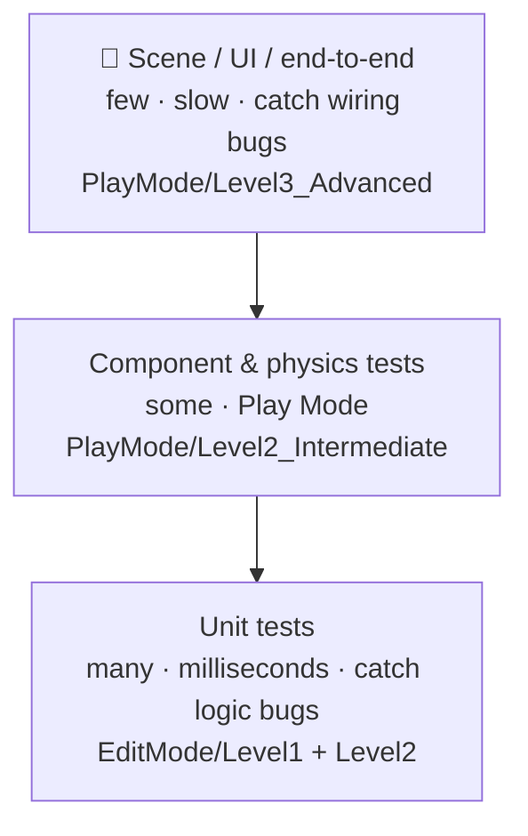

# 🔴 Advanced: testing a whole game

**Goal:** choose the right *kind* of test for each risk, and test things that aren't
"a function returns a value": interactions, scenes, UI, assets and architecture.

## 1. The test pyramid



This project has ~200 Edit Mode tests and ~11 scene tests. That ratio is deliberate.
Scene tests are slow and break for many reasons, so they only check that the pieces are
**connected**. The rules underneath are already covered by fast unit tests.

## 2. Interaction testing with spies (`RunProgressionTests`)

`RunProgression` mostly *tells other objects what to do*: "save the profile", "go to the Shop".
There's little state to assert on, so we check the **calls**:

```csharp
progression.RecordLevelResult(won: true, coinsCollected: 10, levelScore: 100);
progression.ContinueAfterWin();
Assert.That(_navigator.LastDestination, Is.EqualTo(SpyGameNavigator.Shop));
```

You can even check **order** ("saved *before* changing scene"), see `LeaveShop_SavesBeforeLoadingTheArena`.

⚠ Interaction tests know *how* the code works, so they break on refactors more often.
Prefer checking state when there is state. Mocking libraries (Moq, NSubstitute) generate spies
for you; we write them by hand so you can see there's no magic.

## 3. Test Data Builders (`Tests/Shared/Builders`)

```csharp
PlayerProfile profile = A.Profile().WithCoins(50).AtLevel(2);
```

Each test mentions only the values it cares about. When `PlayerProfile`'s constructor changes,
you fix the builder once instead of 40 tests.

## 4. Scene & UI integration tests (`PlayMode/Level3_Advanced`)

Load the real scene, click real buttons, check the real outcome:

```csharp
yield return SceneTestHelpers.LoadScene(SceneNames.MainMenu);
UiTestHelpers.Click("PlayButton");          // refuses hidden or disabled buttons
yield return WaitFor.Condition(() => SceneManager.GetActiveScene().name == SceneNames.Arena, 5f, "Arena never loaded");
```

Things these tests handle that unit tests never have to:
- **Global state:** the game saves to `PlayerPrefs`. `SceneTestBase` backs it up and restores
  it (`PlayerPrefsSandbox`) so tests don't wipe your save or affect each other.
- **Leftover scenes:** a running Arena from one test could collect the next test's coins.
  `[UnityTearDown]` unloads everything.
- **Non-determinism:** enemies move randomly, so the Arena tests turn on `GodMode` and "play"
  by teleporting onto coins: a simple, deterministic bot.
- **Hangs:** `[Timeout(60000)]` on each class turns a stuck test into a failure.

## 5. Content validation (`ContentValidationTests`, `SceneSetupValidationTests`)

Many real bugs are in **data**, not code: a level whose coin goal is higher than the coins that
ever spawn, a duplicate shop SKU, a reference nobody dragged into the Inspector. These tests:

- find every `LevelConfig` asset and run `LevelRules` on it (one test per asset via `[TestCaseSource]`);
- open every scene **without pressing Play** and check for missing scripts, unassigned
  `[SerializeField]` references, a camera, and an EventSystem when there are buttons;
- check prefabs are set up correctly (triggers, kinematic bodies).

> 💡 While this project was being built, `Scene_AllSerializedReferencesAreAssigned` caught a
> real bug in the scene builder: creating a new scene unloaded the ScriptableObjects it was
> about to assign, so every scene silently saved "None". Nobody would have noticed until the
> game crashed on Play.

## 6. Contract tests (`Level3_Advanced/Contracts`)

`KeyValueStorageContract` is an **abstract** test class. Each implementation gets a 3-line
subclass, and NUnit runs the whole contract against each one:

```csharp
public class PlayerPrefsStorageContractTests : KeyValueStorageContract
{
    protected override IKeyValueStorage CreateStorage() => new PlayerPrefsStorage();
}
```

This also proves our **fake** behaves like the **real thing**. A fake that behaves differently
makes every test that uses it lie.

## 7. Property-based testing (`PropertyBasedTests`)

Instead of three hand-picked examples, state a rule that must **always** hold and throw
thousands of random operations at it:

- an inventory never uses more slots than it has, and no count is ever ≤ 0;
- a wallet always matches a dead-simple model (`model += amount`);
- every wave starts exactly once, whatever the frame rate.

The randomness is **seeded** (`SystemRandomSource(seed)` + `[Values(1, 2, 3...)]`), so any
failure is reproducible, and the message prints the seed and step.

## 8. Architecture tests (`ArchitectureTests`)

Reflection over our own assemblies enforces team rules:
- `TestingLab.Core` references no `UnityEngine` (it can be tested anywhere, instantly);
- MonoBehaviours have no public fields;
- every test class has a learning-level `[Category]` matching its folder.

## 9. Continuous integration

`.github/workflows/tests.yml` runs both suites on every push using GameCI. A red build blocks
the merge. Tests you don't run automatically eventually stop being run at all.

## 10. Smells to avoid

| Smell | Why it hurts | Fix |
|-------|--------------|-----|
| Test depends on another test running first | Random failures when order changes | Fresh state in `[SetUp]` |
| `Thread.Sleep` / real waiting in unit tests | Slow, flaky | Fake the clock |
| Asserting on private fields via reflection | Breaks on every refactor | Test through the public API |
| One test checks ten behaviours | First failure hides the rest | One reason to fail per test |
| Scene test for something a unit test could check | Slow suite nobody runs | Push logic down, test it in Edit Mode |
| Test passes even when the code is broken | False confidence | Break the code once, watch it go red |

## ✅ Practise

- `Exercises/Level3_Advanced/AdvancedExercises.cs` (A1–A5), including a TDD exercise
- `PlayMode/Exercises/PlayModeExercises.cs` (P4–P6)
- **Mutation testing by hand:** change `<=` to `<` in `ScoreKeeper.AddPoints`, or remove the
  `Math.Max` in `Health.TakeDamage`. Which tests catch it? If none, write one.
