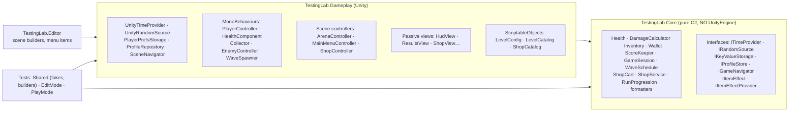
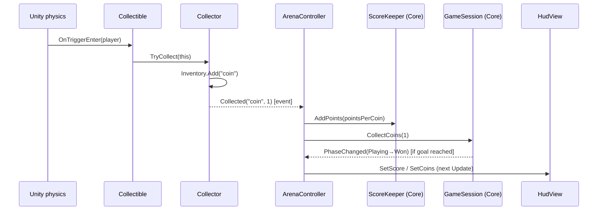

# Architecture & design patterns

The game is small, but it is built the way a production codebase should be, because the
**design is what makes it testable**. Code that is hard to test is usually code that is badly
designed. Tests notice first.

## Layers (assemblies)

- **Core** has *No Engine References* ticked in its `.asmdef`, so it *cannot* use Unity.
  `ArchitectureTests.Core_DoesNotReferenceUnity` keeps it that way. Everything in Core is
  testable in milliseconds.
- **Gameplay** depends on Core, never the other way round. Core defines interfaces (ports);
  Gameplay implements them with Unity (adapters).
- **Tests** reference both. Test doubles live in their own assembly (`Tests/Shared`) so Edit
  Mode and Play Mode tests share them.

## SOLID, with examples from this project

| Principle | Meaning | Where to look |
|-----------|---------|---------------|
| **S**ingle Responsibility | One reason to change | `ShopService` knows checkout rules; `ShopCart` does cart maths; `Wallet` holds money; `ShopView` draws; `ShopController` connects them |
| **O**pen/Closed | Add behaviour without editing existing code | New shop item = new `IItemEffect` class; `ShopService` never changes |
| **L**iskov Substitution | Any implementation can replace another | `InMemoryKeyValueStorage` and `PlayerPrefsStorage` pass the *same* contract tests |
| **I**nterface Segregation | Small, focused interfaces | `IDamageable` has one method; `ContactDamage` doesn't need all of `HealthComponent` |
| **D**ependency Inversion | Depend on abstractions, inject them | `ScoreKeeper(ITimeProvider)`, `RunProgression(IProfileStore, IGameNavigator)` |

## Design patterns used

| Pattern | Where | Why it helps testing |
|---------|-------|---------------------|
| **Humble Object** | `HealthComponent`↔`Health`, `EnemyController`↔`ChaseBrain`, views↔formatters | Logic moves out of hard-to-test MonoBehaviours |
| **Dependency Injection** (constructor / method) | `ScoreKeeper`, `DamageCalculator`, `DamageReceiver.Construct` | Tests pass fakes |
| **Composition Root** | `GameServices`, `ArenaController.Start` | One place picks real implementations; no singletons |
| **Strategy** | `IItemEffect` (`ArmorBoost`, `SpeedBoost`…), `IPlayerInput` | Swap behaviour (keyboard ↔ scripted input) |
| **State machine** | `GameSession`, `ChaseBrain` | Every transition is a small, clear test |
| **Observer** | C# events: `Health.Died`, `Collector.Collected`, `WaveSchedule.WaveStarted` | Systems don't know about each other |
| **Repository** | `IProfileStore` / `ProfileRepository` | Storage is swappable |
| **Adapter** | `PlayerPrefsStorage`, `UnityTimeProvider` | Wraps Unity statics behind interfaces |
| **DTO** | `ProfileDto` | Domain objects stay protected; JsonUtility gets public fields |
| **Factory / Factory Method** | `UiFactory`, `ShopItemDefinition.CreateEffect`, `WaveSpawner` | Construction in one place |
| **Passive View (MVP)** | `*View` + `*Controller` | Views contain no logic to test |
| **Mediator** | `ArenaController` | Connects systems so they don't reference each other |
| **ScriptableObject config** | `LevelConfig`, `ShopCatalog` | Data-driven; validated by content tests |
| **Test Data Builder** | `A.Profile()...` | Readable, refactor-proof tests |

### Why no Singletons or a global `GameManager.Instance`?

A singleton is a global variable with a nicer name. Any class can reach it, so you can't tell
from a constructor what a class depends on, and tests must remember to reset it or they leak
into each other. Here, dependencies are passed in explicitly, and the **composition root** is
the only place that knows the concrete types.

## Conventions

- `[SerializeField] private` fields for the Inspector, properties for code (an architecture test enforces this).
- One class per file, file name = class name (required for MonoBehaviours and ScriptableObjects).
- Namespaces follow folders: `TestingLab.Core.Combat`, `TestingLab.Gameplay.UI`, …
- Scene names, asset paths and test categories are **constants**, never repeated strings.
- Each source file's header lists its learning level, pattern and the test that covers it.
- Test names: `What_When_ExpectedResult`. Test bodies: Arrange / Act / Assert.

## How a coin pickup flows through the code

Each arrow is covered: `CollectibleTests` (physics → Collector), `ScoreKeeperTests`,
`GameSessionTests`, `HudFormatterTests`, and `ArenaSceneTests` for the whole chain.

## Regenerating content

Scenes, prefabs and data assets were generated by `Assets/Scripts/Editor/Builders` and are
committed like normal assets. Edit them freely. **Testing Lab ▸ Rebuild Game Content**
regenerates everything from code (overwriting manual changes).
