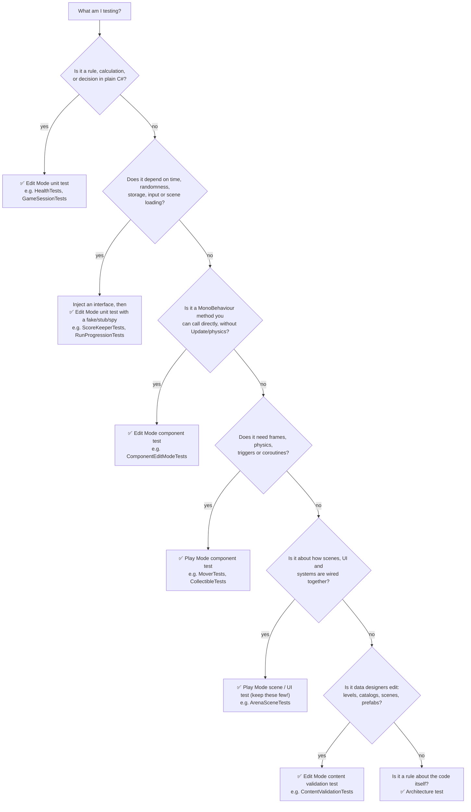

# Which test should I write?

Ask these questions in order and stop at the first "yes".

## Quick reference by bug type

| "I'm worried that…" | Write a… | Example in this project |
|---|---|---|
| the maths is wrong | unit test, `[TestCase]` table | `DamageCalculatorTests` |
| an edge case crashes | unit test at the boundary | `WalletTests.TrySpend_OneMoreThanBalance…` |
| it only breaks sometimes (timing, luck) | unit test with fake time/random | `ScoreKeeperTests`, `SpawnPointPickerTests` |
| a state change happens at the wrong time | state-machine tests | `GameSessionTests` |
| an event isn't raised (or raised twice) | unit test that subscribes and counts | `HealthTests.Died_IsRaisedExactlyOnce` |
| the wrong collaborator gets called | interaction test with a spy | `RunProgressionTests` |
| the save file loses data | round-trip test with fake storage | `ProfileRepositoryTests` |
| my fake doesn't behave like the real thing | contract test | `KeyValueStorageContract` |
| a rule might break under weird sequences | property-based test | `PropertyBasedTests` |
| things don't move/collide in-game | Play Mode component test | `PlayerControllerTests`, `ContactDamageTests` |
| a button does nothing | Play Mode UI test | `MainMenuSceneTests` |
| the whole loop doesn't work | Play Mode end-to-end test | `ArenaSceneTests.CollectingEnoughCoins…` |
| a designer makes a level unwinnable | content validation | `ContentValidationTests` |
| someone forgets to assign a reference | scene validation | `SceneSetupValidationTests` |
| someone adds `using UnityEngine` to Core | architecture test | `ArchitectureTests` |
| a bug I fixed comes back | **regression test**: reproduce it first, then fix | `ShopCartBugHuntTests` |

## Not everything needs a test

`KeyboardPlayerInput`, `Spinner` and `SceneNavigator` have no tests. They contain no decisions,
only calls into Unity. Testing them would mostly test Unity. Keep such classes **humble**
(tiny), and put anything worth testing somewhere else.
